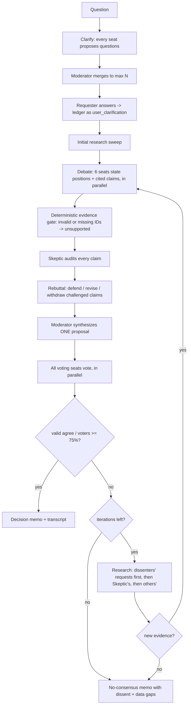

# Product Council — Design

## 1. Purpose

Product Council is a service that takes in a **customer-gap question** (e.g. *"Field members report there is no
day-2 operations guidance after migration — should we build a post-migration guidance and recommendation
experience for on-premises customers?"*) and returns an **evidence-backed, cross-functional decision**.

The goal is **not** to productize every gap. The goal is **alignment**: a proposal (build, pilot, partner,
defer or do_not_build) that at least **75 % of voting seats agree on, with cited evidence**. If the council can't
get there, it researches more data and debates again. If research runs dry, it reports *no consensus* and says
exactly which data is missing.

### Non-goals
- Replacing human product governance. The council's output is a decision memo for humans to ratify.
- Producing roadmaps, specs or cost models beyond what the evidence supports.

## 2. Council composition

| Seat | Lens | Votes |
|---|---|---|
| Customer Success | Time-to-value, adoption, retention/renewal risk, field feedback | ✅ |
| Engineering | Feasibility, reuse, cost to build/operate, technical risk, opportunity cost | ✅ |
| Product | Problem size, segment, team/company vision fit, MVP scope, build/partner/buy | ✅ |
| Marketing | Demand, competitive landscape, differentiation, GTM, ecosystem | ✅ |
| Security | Threat model, compliance, least privilege, secure-by-default, gap-induced exposure | ✅ |
| Support | Case volume and drivers, deflection, troubleshooting burden, escalations | ✅ |
| **Skeptic** | Audits every claim: the citation must exist *and* support the claim | ✅ (configurable) |
| Moderator | Neutral facilitator: merges questions, synthesizes the proposal | ❌ |

**Model diversity.** Each seat is bound to a `(provider, model)` in config. Spreading seats across model
families (e.g. GPT-family, Claude-family, a reasoning model for the Skeptic) reduces correlated blind spots and
"same-model groupthink". The Skeptic should run on a different family from the majority of seats.

## 3. Lifecycle



### 3.1 Clarification (before any debate)
Every seat, including the Skeptic, proposes up to 2 questions "whose answer would change the decision". The
Moderator dedupes them and ranks by decision impact (default max 5). Answers enter the evidence ledger as
`user_clarification` items, so they can be cited and audited like any other evidence. Unanswered questions are
dropped, not invented.

### 3.2 Debate → challenge → rebuttal
- **Statement**: each functional seat returns a `position` (support/oppose/conditional), a summary, `claims[]`
  (each with `evidence_ids` and `is_assumption`), and `research_requests[]`.
- **Deterministic evidence gate** (code, not LLM): every cited ID is checked against the ledger. A claim with no
  valid ID is `unsupported` and can't be upgraded by any model, including a lenient Skeptic. Hallucinated IDs
  are recorded as `invalid_evidence_ids`.
- **Skeptic audit**: for each claim, the verdict is `supported`, `weak` or `unsupported`, with the reason and
  `required_evidence`. Self-declared assumptions are capped at `weak`. The Skeptic watches for sample bias, stale
  data, correlation vs. causation, vision statements used as proof of demand, and unquantified impact.
- **Rebuttal**: each challenged seat must defend the claim (adding valid evidence), revise it to what the
  evidence supports, or withdraw it. A defense without valid evidence leaves the challenge `unresolved`.

### 3.3 Proposal and vote
The Moderator writes **one** proposal per iteration, using only supported or defended claims as premises. From
iteration 2 on, it must address dissenters' conditions where the evidence allows. The decision can be any of
`build | pilot | partner | defer | do_not_build`. "Do not build" is a valid consensus.

Each voter returns `agree|disagree`, a rationale, `evidence_ids`, conditions, and **what would change my mind**.

### 3.4 Consensus rule
```
consensus = (# valid "agree" votes) / (# voting seats) >= threshold (default 0.75)
```
- The denominator is **all** voting seats. Abstentions, agent failures and invalid votes count against.
- An `agree` vote **must cite at least one valid evidence ID**, or it is invalid. This keeps "backed by data"
  true for the final decision, not just the debate.
- With 7 voters you need 6 (86 %), because 5/7 = 71 %. With the Skeptic non-voting (6 voters) you need 5 (83 %).
  Exactly 75 % (e.g. 3/4) passes; set `consensus_threshold` slightly higher if "strictly over 75 %" is required.

### 3.5 Research loop (when consensus < 75 %)
1. **Collect requests.** Dissenting voters' requests (and their "what would change my mind") come first, then the
   Skeptic's and other seats'. Requests are deduped and capped per round (`max_research_requests`).
2. **Route by source type.** Each request names the source types it wants. Requests with no type go to all sources.

   | Source type | Examples |
   |---|---|
   | `internal_doc` | Microsoft internal docs, telemetry reports, support case analysis, competitive intel |
   | `customer_interview` | Interview notes, field feedback, CAB transcripts |
   | `team_vision` / `company_vision` | Team charter and roadmap, company priorities |
   | `partnership` | Other teams' emerging products, partner programs |
   | `user_provided` | Human-in-the-loop: the operator pastes new data (e.g. fresh interviews) |
3. **Ingest.** New hits are appended to the ledger with stable IDs (`E###`), source location, the query that found
   them, and the iteration. The ledger is append-only and deduped by content fingerprint.
4. **Re-debate.** The next iteration sees the previous proposal, the votes, unresolved challenges and the new
   evidence IDs.
5. **Stop conditions.** The loop stops when consensus is reached, after `max_iterations`, or (if
   `stop_when_research_exhausted`) when a research round finds nothing new. Debating again on identical data
   tends to produce drift, not alignment.

## 4. Data model (see `product_council/schemas.py`)

- `Evidence {id, source_type, title, location, excerpt, retrieved_iteration, query}` — the only citable unit.
- `Claim {id, role, iteration, text, evidence_ids, invalid_evidence_ids, is_assumption, status}`, where status is
  `unverified → supported | weak | unsupported → defended | withdrawn`.
- `Challenge {claim_id, target_role, verdict, reason, required_evidence, resolution}`
- `Proposal {id, decision, scope, out_of_scope, success_metrics, risks_and_mitigations, open_questions, evidence_ids}`
- `Vote {role, vote, rationale, evidence_ids, conditions, what_would_change_my_mind, valid, invalid_reason}`
- `IterationRecord`, `CouncilOutcome`. The outcome serializes to `transcript.json` as the full audit trail.

All model I/O is **structured JSON** against per-task schemas (`prompts.py`). Parse failures are retried with a
corrective instruction. A seat that still fails after the retries is recorded as an invalid vote and never as
silent agreement.

## 5. Architecture

### 5.1 Reference implementation (this repo)
```
product_council/
  orchestrator.py   state machine, evidence gate, tallying, research prioritization
  roles.py          council charter + seat mandates (system prompts)
  prompts.py        per-task instructions + JSON schemas, robust JSON parsing
  research.py       EvidenceLedger, ResearchEngine, LocalCorpusSource (TF-IDF), HumanSource
  providers/        LLMProvider interface: azure_openai, openai, anthropic, mock
  config.py         TOML config, ${ENV} expansion, seat->model binding
  report.py         decision memo (Markdown)
  cli.py            `python -m product_council run ...`
```
Seats run in parallel (`asyncio.gather`) inside each phase, and phases run in order.

### 5.2 Production deployment (Azure)
| Concern | Choice |
|---|---|
| API / orchestration | Container Apps (or Functions Durable) hosting the orchestrator; one durable workflow per council session so long research waits (human input) survive restarts |
| Models | Azure AI Foundry deployments (GPT-family, reasoning models, and partner models such as Claude where available); Entra ID auth via managed identity, no keys |
| Internal documents | Azure AI Search index over SharePoint/OneDrive/ADO wiki exports, queried **on behalf of the requesting user** so the council can only cite what the requester can read |
| Customer interviews | Interview repository (e.g. Dataverse/SharePoint list) exposed as a `ResearchSource`; PII redacted at ingestion |
| Vision / strategy | Curated, versioned index (team vision, company priorities) with an effective date on each document |
| Partnerships | Catalog of internal emerging products (owner, stage, APIs) as a `ResearchSource` |
| State & audit | Cosmos DB: sessions, ledger, claims, votes; immutable transcript blob for every decision |
| UI | Teams app / web: question intake, clarifying Q&A, live debate stream, human research tasks, final memo |
| Observability | OpenTelemetry traces per seat call (model, tokens, latency, verdict); dashboards for consensus rate, iterations-to-consensus, invalid-citation rate |

## 6. Responsible AI, security and privacy

- **Prompt injection via evidence.** Retrieved documents are data, not instructions. They are delimited in the
  prompt, and the evidence gate means an injected "agree" can't be turned into a valid vote without a real
  citation. In production, also strip or neutralize instruction-like text at ingestion.
- **Authorization.** Retrieval is security-trimmed to the requesting user. Transcripts inherit the most
  restrictive label of any evidence cited.
- **Confidentiality.** Third-party model providers only receive content the data-classification policy allows.
  Seats can be pinned to in-tenant models for restricted sessions.
- **No fabricated data.** The council charter, the deterministic gate, the Skeptic, and the "agree must cite"
  rule all apply. The memo lists every evidence item with its location so humans can verify it.
- **Human accountability.** The memo is advisory. A named product owner ratifies or overrides it, and overrides are
  logged.

## 7. Evaluation

- **Golden scenarios**: historical gaps with known outcomes (shipped and succeeded, shipped and failed, rightly
  declined). Measure decision agreement with hindsight and with human councils.
- **Evidence quality**: rates of invalid citations, unsupported claims surviving to the proposal, and Skeptic
  precision/recall against human audits.
- **Process health**: iterations-to-consensus, no-consensus rate, research yield per round, cost and latency per
  session.
- **Ablations**: single-model vs. mixed-model seats, and Skeptic voting vs. non-voting.

## 8. Configuration knobs (`council.toml`)

`consensus_threshold` (0.75), `max_iterations` (4), `max_clarifying_questions` (5), `initial_top_k`,
`research_top_k`, `max_research_requests`, `stop_when_research_exhausted`, `skeptic_votes`, per-seat
`provider/model/temperature/max_tokens`, `[[sources]]`.

## 9. Known limitations and next steps
- The local TF-IDF source is a stand-in. Production should use hybrid/semantic search with re-ranking.
- Rebuttal-defended claims are gated deterministically but not re-audited by the Skeptic until the vote. A second
  Skeptic pass is a cheap addition if needed.
- A single proposal per iteration keeps the vote binary and auditable. A ranked-choice variant (multiple proposals)
  could converge faster on contentious gaps.
- Add cost/latency budgets per session and early-exit when the vote is mathematically decided.
